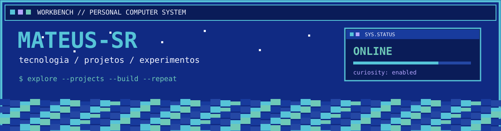
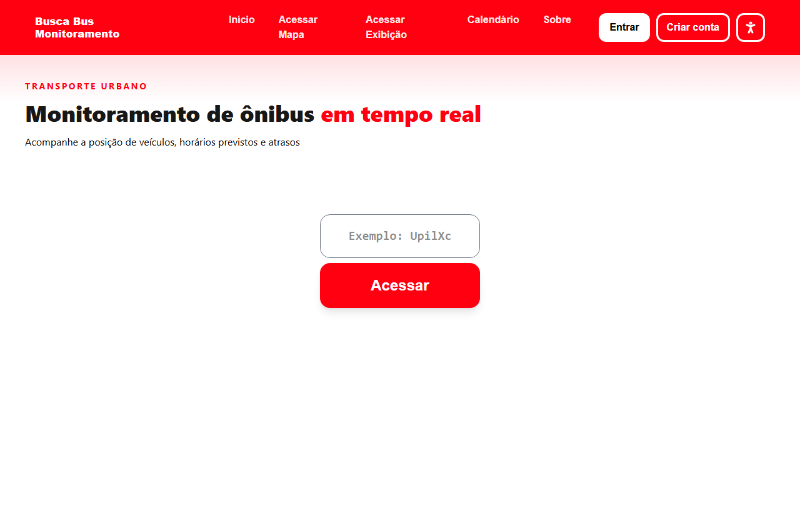
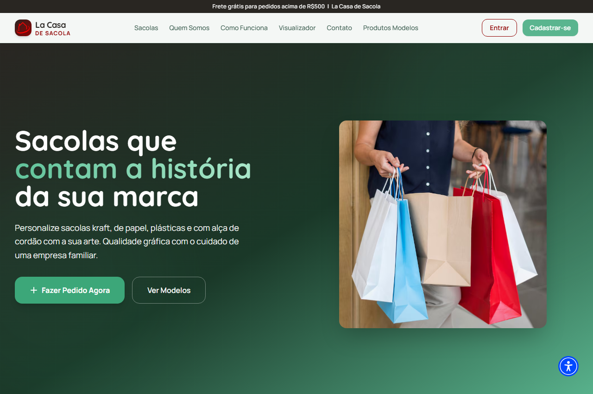
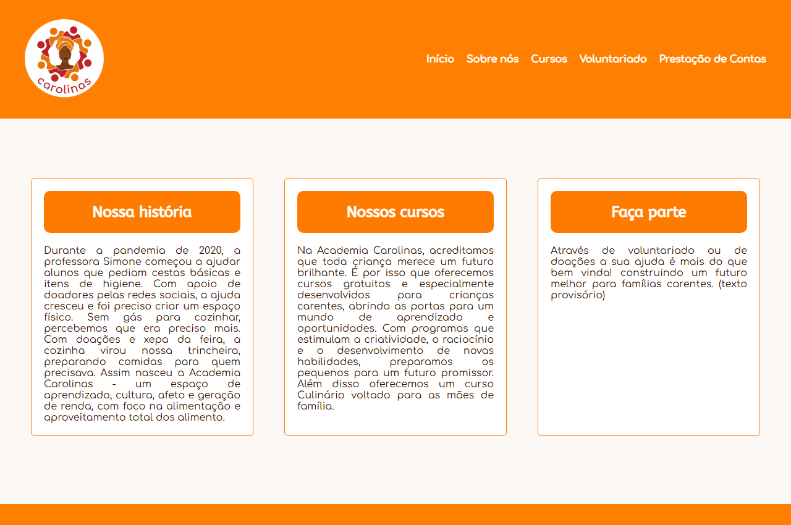
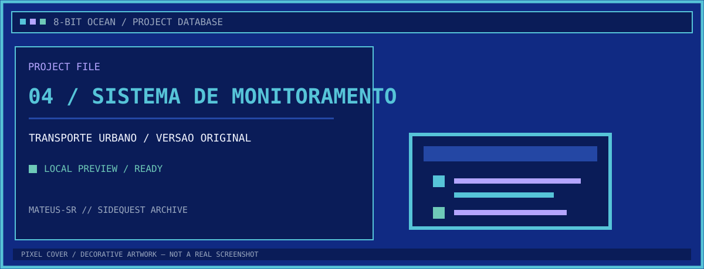
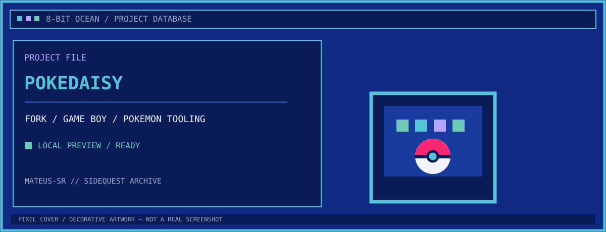
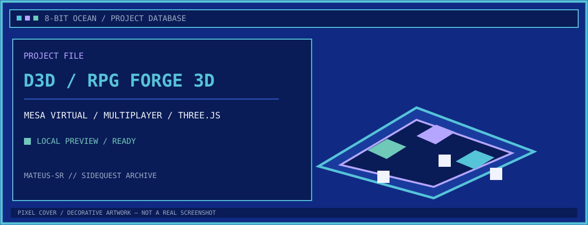
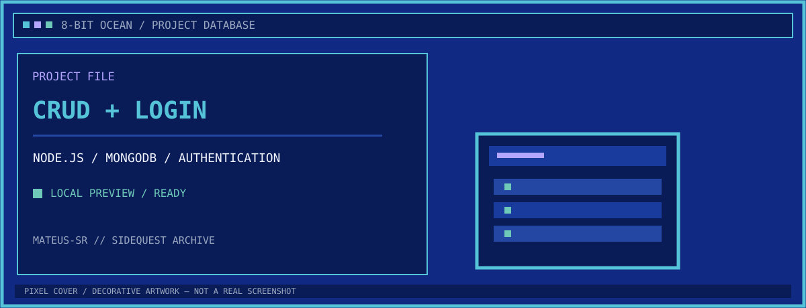
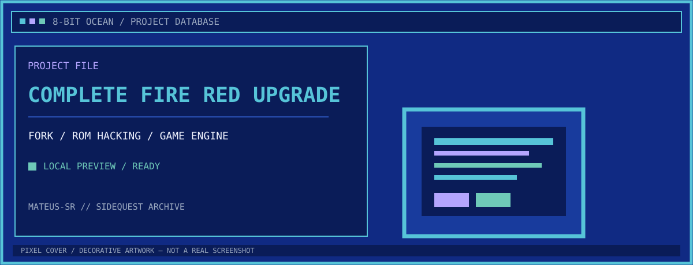
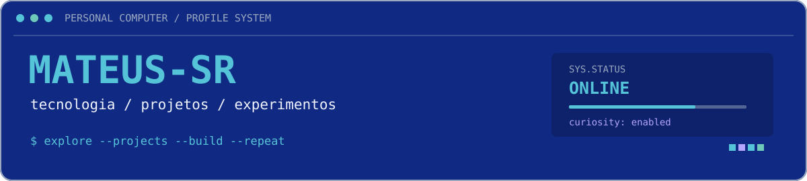

  

  <code>PROFILE MODE: EXPLORER</code>  
  <code>STATUS: ONLINE</code>  
  <code>CURIOSITY: ENABLED</code>

  <a href="#01--college-projects">COLLEGE PROJECTS</a> /
  <a href="#02--sidequests">SIDEQUESTS</a> /
  <a href="#03--tech-inventory">TECH INVENTORY</a> /
  <a href="#04--system-telemetry">SYSTEM TELEMETRY</a>

<h2 id="01--college-projects">
  
  01 / COLLEGE PROJECTS
</h2>

<code>FATEC DSM // ACADEMIC BUILDS // 04 RECORDS</code>

  Projetos desenvolvidos na Fatec Zona Leste, reunindo aplicações
  web, sistemas úteis e experiências de desenvolvimento.

<table width="100%" border="1" cellpadding="12" cellspacing="0">
  <tr>
    <td width="50%" valign="top">
      
      <h3>01 / Busca Bus</h3>
      
<code>FATEC DSM 2026/2 · WEB / REALTIME</code>

      

        Sistema de monitoramento de ônibus em tempo real para São Paulo.
        Consulta a API Olho Vivo da SPTrans e distribui atualizações
        usando WebSocket/Socket.IO. Esta é a versão refeita em React/Next.js.
      

      

        <a href="https://busca-bus-web.onrender.com/exibicao?codigo=dev">[ DEMO AO VIVO ]</a> 
        <a href="https://github.com/Mateus-SR/Busca-Bus-React">[ CÓDIGO-FONTE ]</a>
      

    </td>
    <td width="50%" valign="top">
      
      <h3>02 / La Casa de Sacola</h3>
      
<code>FATEC DSM 2026/1 · E-COMMERCE</code>

      

        Aplicação de e-commerce para facilitar vendas e registros
        de uma loja de sacolas personalizadas.
      

      

        <a href="https://la-casa-de-sacola-test.vercel.app/">[ DEMO DE TESTE ]</a> 
        <a href="https://github.com/Mateus-SR/La-Casa-De-Sacola">[ CÓDIGO-FONTE ]</a>
      

    </td>
  </tr>
  <tr>
    <td width="50%" valign="top">
      
      <h3>03 / Website ONG Academia Carolinas</h3>
      
<code>FATEC DSM 2025/1 · INSTITUTIONAL</code>

      

        Website institucional desenvolvido para apresentar a ONG
        Academia Carolinas, suas iniciativas e informações públicas.
      

      

        <a href="https://mateus-sr.github.io/Website-ONG-AcademiaCarolinas/">[ ABRIR SITE ]</a> 
        <a href="https://github.com/Mateus-SR/Website-ONG-AcademiaCarolinas">[ CÓDIGO-FONTE ]</a>
      

    </td>
    <td width="50%" valign="top">
      
      <h3>04 / Sistema de Monitoramento de Linhas de Ônibus</h3>
      
<code>FATEC DSM 2025/2 · VERSÃO ORIGINAL</code>

      

        Primeira implementação do sistema de monitoramento de ônibus.
        Serviu de base para a versão posterior reescrita com React/Next.js,
        substituindo a implementação anterior em Jekyll, JavaScript e Supabase.
      

      

        <a href="https://github.com/Mateus-SR/Sistema-Monitoramento-Linhas-Onibus">[ REPOSITÓRIO ]</a>
      

    </td>
  </tr>
</table>

<h2 id="02--sidequests">
  
  02 / SIDEQUESTS
</h2>

<code>OPTIONAL MISSIONS // PERSONAL PROJECTS & EXPERIMENTS</code>

  Projetos que exploram outros interesses, de ferramentas para RPGs
  a jogos, emulação e desenvolvimento web.

<table width="100%" border="1" cellpadding="12" cellspacing="0">
  <tr>
    <td width="50%" valign="top">
      
      <h3>PokeDaisy</h3>
      
<code>FORK / ANDROID / POKEMON</code>

      

        Fork de um player para jogos Game Boy, Game Boy Color e GBA
        em dispositivos Android, com um painel auxiliar para informações
        de jogos Pokémon e ROM hacks. O projeto original é de lidor30.
      

      

        <a href="https://github.com/Mateus-SR/pokedaisy">[ MEU FORK ]</a> 
        <a href="https://github.com/lidor30/pokedaisy">[ PROJETO ORIGINAL ]</a>
      

    </td>
    <td width="50%" valign="top">
      
      <h3>D3D</h3>
      
<code>THREE.JS / SOCKET.IO / MULTIPLAYER</code>

      

        Mesa virtual 3D para RPGs com salas multiplayer, importação de
        mapas e tokens e sincronização de movimentos entre participantes.
      

      

        <a href="https://github.com/Mateus-SR/D3D">[ CÓDIGO-FONTE ]</a>
      

    </td>
  </tr>
  <tr>
    <td width="50%" valign="top">
      
      <h3>CRUD + Login</h3>
      
<code>NODE.JS / MONGODB / AUTH</code>

      

        Aplicação para um sebo fictício, com operações CRUD e autenticação.
        O projeto explora MongoDB, Node.js, JWT, Cloudinary e Jekyll.
      

      

        <a href="https://mateus-sr.github.io/DevWebII-Projeto-CRUD-Login/loginCRUD/views/index.html">[ DEMO ]</a> 
        <a href="https://github.com/Mateus-SR/DevWebII-Projeto-CRUD-Login">[ CÓDIGO-FONTE ]</a>
      

    </td>
    <td width="50%" valign="top">
      
      <h3>Complete Fire Red Upgrade</h3>
      
<code>FORK / ROM HACKING / GAME ENGINE</code>

      

        Fork de um projeto de aprimoramento de Pokémon FireRed,
        com motor de batalha expandido e numerosas opções de jogo.
        O projeto original é de Skeli789. Usado em projeto de hackrom pessoal.
      

      

        <a href="https://github.com/Mateus-SR/Complete-Fire-Red-Upgrade">[ MEU FORK ]</a> 
        <a href="https://github.com/Skeli789/Complete-Fire-Red-Upgrade">[ PROJETO ORIGINAL ]</a>
      

    </td>
  </tr>
</table>

<h2 id="03--tech-inventory">
  
  03 / TECH INVENTORY
</h2>

Tecnologias presentes entre os projetos do perfil.

<code>WEB / UI</code> 

<code>SERVER / REALTIME</code> 

<code>DATA / SERVICES</code> 

<code>TOOLS ARE MEANS, NOT THE DESTINATION</code>

<h2 id="04--system-telemetry">
  
  04 / SYSTEM TELEMETRY
</h2>

<code>GITHUB ACCOUNT // REMOTE STATS</code>

<table width="100%" border="1" cellpadding="8" cellspacing="0">
<tr>
<td width="50%" valign="top">

</td>
<td width="50%" valign="top">

</td>
</tr>
</table>

  <code>STATUS: ONLINE</code> /
  <code>BUGS: EXPECTED</code> /
  <code>CONTINUE EXPLORING...</code>

  
  <code>END OF TRANSMISSION // OBRIGADO PELA VISITA</code>

  

  <a href="#projetos-em-destaque">Projetos</a> ·
  <a href="#tecnologias">Tecnologias</a> ·
  <a href="#estatisticas-do-github">Estatísticas</a> ·
  <a href="https://github.com/Mateus-SR">GitHub</a>

---