

  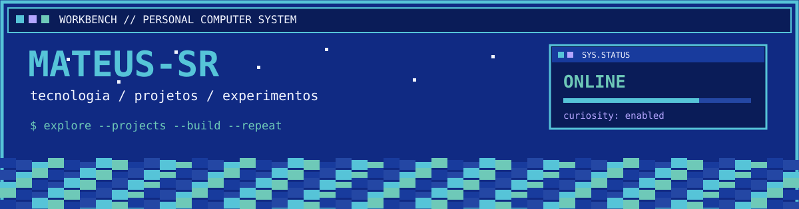
  
<code>PROFILE MODE: EXPLORER</code> &nbsp; <code>STATUS: ONLINE</code>

## GitHub Activity

### Arcade Contribution Graph

  <picture>
    <source media="(prefers-color-scheme: dark)" srcset="https://raw.githubusercontent.com/Mateus-SR/Mateus-SR/output/arcade-contribution-graph-dark.svg"/>
    <source media="(prefers-color-scheme: light)" srcset="https://raw.githubusercontent.com/Mateus-SR/Mateus-SR/output/arcade-contribution-graph.svg"/>
    
  </picture>

Um jogo diferente é selecionado a cada atualização diária · <a href="https://github.com/abozanona/pacman-contribution-graph">Pacman Contribution Graph</a>

### Profile Cards

  <picture>
    <source media="(prefers-color-scheme: dark)" srcset="assets/overview.dark.svg"/>
    <source media="(prefers-color-scheme: light)" srcset="assets/overview.light.svg"/>
    
  </picture>

<table width="100%" cellpadding="6" cellspacing="0">
  <tr>
    <td width="50%" valign="top">
      <picture>
        <source media="(prefers-color-scheme: dark)" srcset="assets/lifetime.dark.svg"/>
        <source media="(prefers-color-scheme: light)" srcset="assets/lifetime.light.svg"/>
        
      </picture>
    </td>
    <td width="50%" valign="top">
      <picture>
        <source media="(prefers-color-scheme: dark)" srcset="assets/repositories.dark.svg"/>
        <source media="(prefers-color-scheme: light)" srcset="assets/repositories.light.svg"/>
        
      </picture>
    </td>
  </tr>
</table>

### Terminal

  

---

## College Projects

<code>FATEC DSM // ACADEMIC BUILDS</code>

Projetos desenvolvidos na Fatec Zona Leste, reunindo aplicações web, sistemas úteis e experiências de desenvolvimento.

<table width="100%" border="1" cellpadding="10" cellspacing="0">
  <tr>
    <td width="50%" valign="top">
      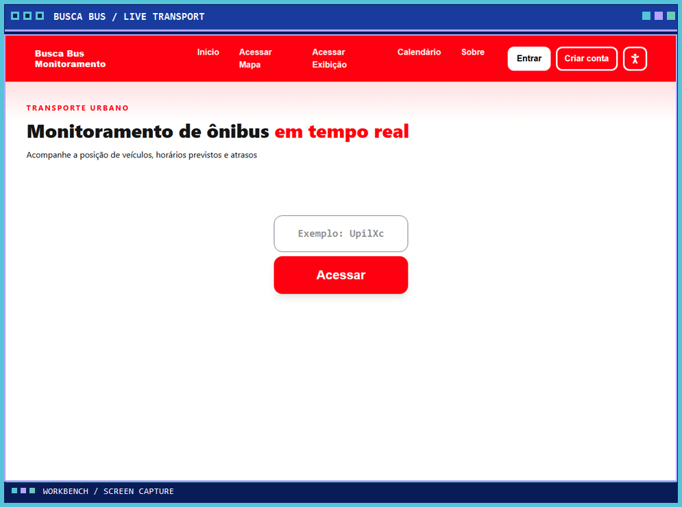
      <h3>Busca Bus</h3>
      
Sistema de monitoramento de ônibus em tempo real para São Paulo. Consulta a API Olho Vivo da SPTrans e distribui atualizações usando WebSocket/Socket.IO. Esta é a versão refeita em React/Next.js.

      <a href="https://busca-bus-web.onrender.com/exibicao?codigo=dev">Demo ao vivo</a> · <a href="https://github.com/Mateus-SR/Busca-Bus-React">Código-fonte</a>
    </td>
    <td width="50%" valign="top">
      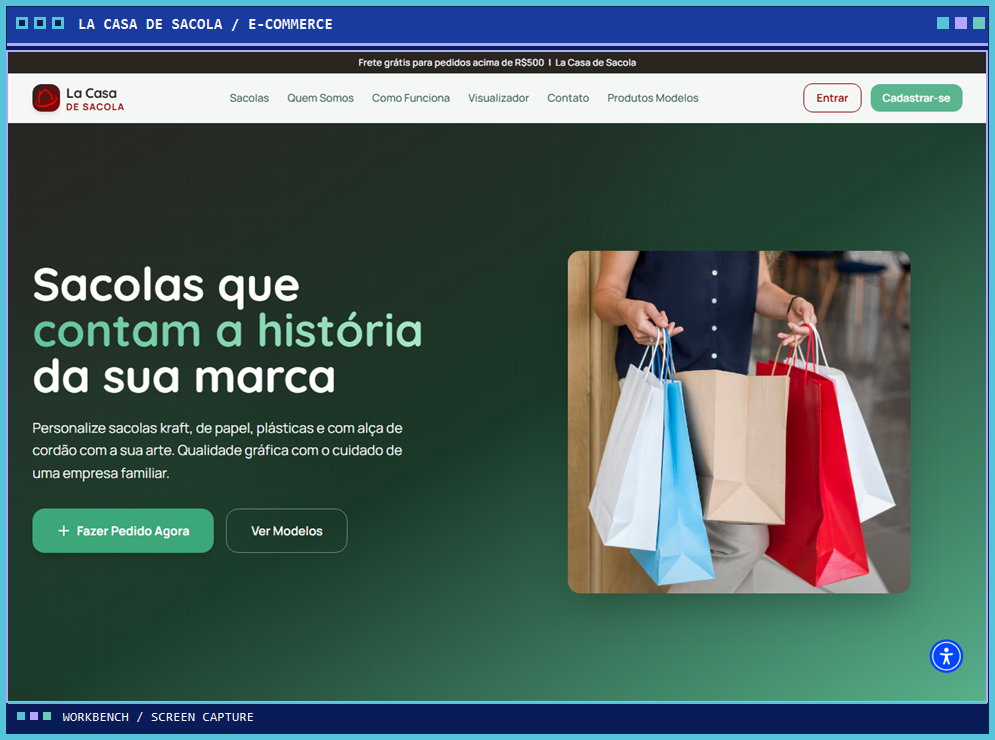
      <h3>La Casa de Sacola</h3>
      
Aplicação de e-commerce para facilitar vendas e registros de uma loja de sacolas personalizadas.

      <a href="https://la-casa-de-sacola-test.vercel.app/">Demo de teste</a> · <a href="https://github.com/Mateus-SR/La-Casa-De-Sacola">Código-fonte</a>
    </td>
  </tr>
  <tr>
    <td width="50%" valign="top">
      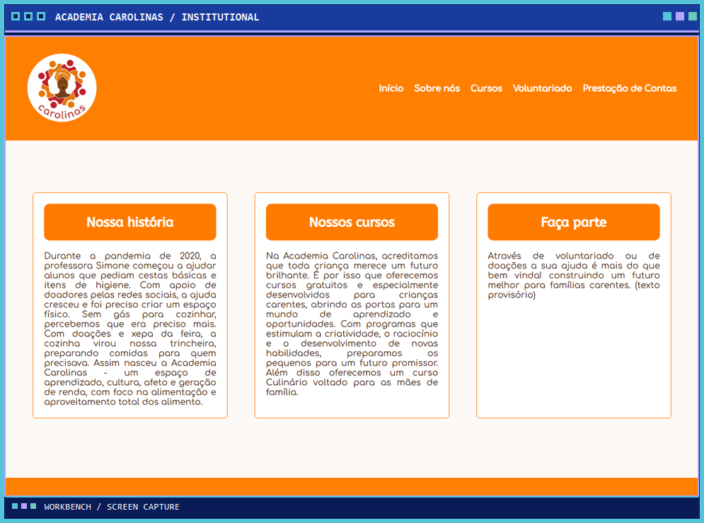
      <h3>Website ONG Academia Carolinas</h3>
      
Website institucional desenvolvido para apresentar a ONG Academia Carolinas, suas iniciativas e informações públicas.

      <a href="https://mateus-sr.github.io/Website-ONG-AcademiaCarolinas/">Abrir site</a> · <a href="https://github.com/Mateus-SR/Website-ONG-AcademiaCarolinas">Código-fonte</a>
    </td>
    <td width="50%" valign="top">
      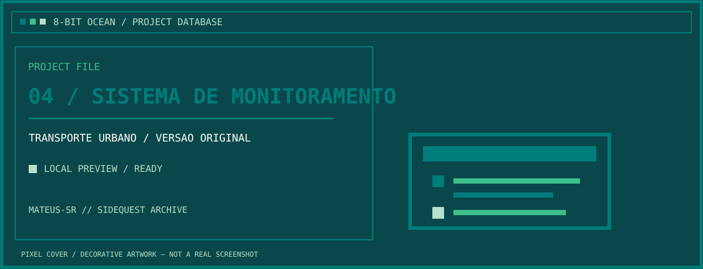
      <h3>Sistema de Monitoramento de Linhas de Ônibus</h3>
      
Primeira implementação do sistema de monitoramento de ônibus, que serviu de base para a versão posterior refeita com React/Next.js.

      <a href="https://github.com/Mateus-SR/Sistema-Monitoramento-Linhas-Onibus">Repositório</a>
    </td>
  </tr>
</table>

## Sidequests

<code>PERSONAL PROJECTS // EXPERIMENTS</code>

<table width="100%" border="1" cellpadding="10" cellspacing="0">
  <tr>
    <td width="50%" valign="top">
      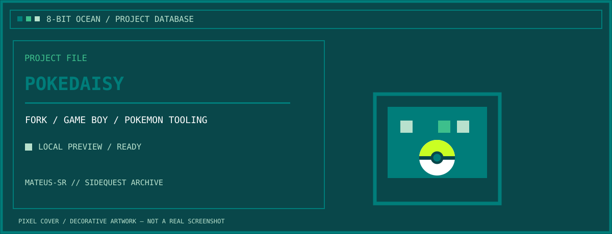
      <h3>PokeDaisy</h3>
      
Fork de um player para jogos Game Boy, Game Boy Color e GBA em dispositivos Android, com painel auxiliar para informações de jogos Pokémon e ROM hacks. Projeto original de lidor30.

      <a href="https://github.com/Mateus-SR/pokedaisy">Meu fork</a> · <a href="https://github.com/lidor30/pokedaisy">Original</a>
    </td>
    <td width="50%" valign="top">
      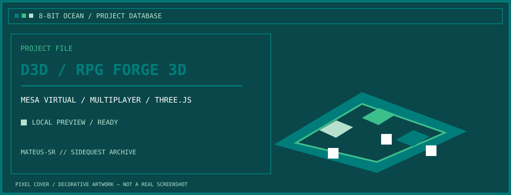
      <h3>D3D</h3>
      
Mesa virtual 3D para RPGs com salas multiplayer, importação de mapas e tokens e sincronização de movimentos.

      <a href="https://github.com/Mateus-SR/D3D">Código-fonte</a>
    </td>
  </tr>
  <tr>
    <td width="50%" valign="top">
      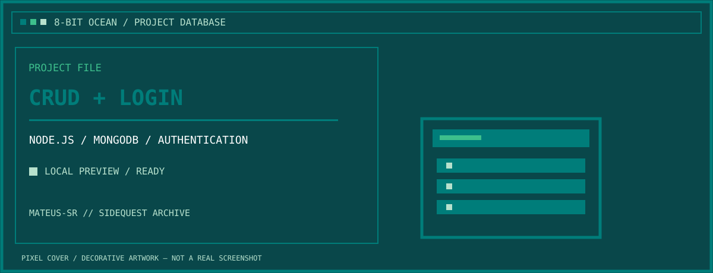
      <h3>CRUD + Login</h3>
      
Aplicação para um sebo fictício, com operações CRUD e autenticação usando MongoDB, Node.js, JWT, Cloudinary e Jekyll.

      <a href="https://mateus-sr.github.io/DevWebII-Projeto-CRUD-Login/loginCRUD/views/index.html">Demo</a> · <a href="https://github.com/Mateus-SR/DevWebII-Projeto-CRUD-Login">Código-fonte</a>
    </td>
    <td width="50%" valign="top">
      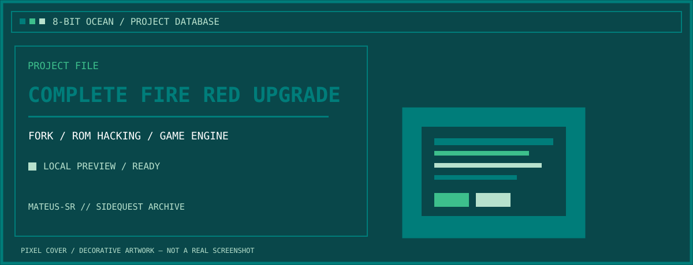
      <h3>Complete Fire Red Upgrade</h3>
      
Fork de um projeto de aprimoramento de Pokémon FireRed, com motor de batalha expandido e diversas opções de jogo. Projeto original de Skeli789.

      <a href="https://github.com/Mateus-SR/Complete-Fire-Red-Upgrade">Meu fork</a> · <a href="https://github.com/Skeli789/Complete-Fire-Red-Upgrade">Original</a>
    </td>
  </tr>
</table>

<code>END OF TRANSMISSION // OBRIGADO PELA VISITA</code>

